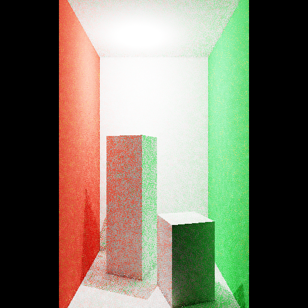

# Falcor Surfel + ReSTIR GI

基于 Falcor 9.0 的实时漫反射全局光照实验。这个项目把世界空间 **Surfel 辐照度缓存**接入 **ReSTIR GI**，用于观察多次反弹和时空复用各自如何影响间接光。



## 算法

每个像素从可见表面发射一条漫反射候选射线。在射线命中的二次表面，程序用 NEE 估计直接光，并查询 Surfel 缓存补充更高阶的反弹。两部分亮度一起进入 ReSTIR 的选样权重和最终间接光。

以阴影里的地板为例，**太阳 → 石柱 → 地板 → 相机** 是一次间接反弹。Surfel 缓存还可以补充 **太阳 → 红墙 → 石柱 → 地板 → 相机** 这类路径的贡献。

- [算法学习笔记](docs/restir-gi-surfel-notes.md) 包含射线示意图、NEE 与 Surfel 的分工和 Mogwai 对照实验。
- [C++ 和 Slang 实现](Source/RenderPasses/SurfelReSTIRGI) 包含渲染 Pass、缓存更新和蓄水池重采样。
- [学习版渲染图](scripts/SurfelReSTIRGI_Study.py) 提供 12 个阶段输出，包括面元圆片、初始候选、时间复用、空间复用和最终合成。

## 在 Windows 上运行

从仓库根目录运行以下命令，使用 Visual Studio 2022 和 Vulkan。通过 `git clone --recurse-submodules` 获取仓库可以同时拉取 Falcor 的 Git 子模块。

```powershell
.\setup_vs2022.bat
cmake --build .\build\windows-vs2022 --config Release --target Mogwai --parallel 6
.\build\windows-vs2022\bin\Release\Mogwai.exe -d vulkan -s scripts/SurfelReSTIRGI_Study.py -S scripts/SurfelReSTIRGI_Cornell.pyscene --width 960 --height 540 -v 2
```

在 Mogwai 的 **Output** 下拉框依次选 `GI.surfelDiscs`、`SurfelOnly.dst`、`CandidateIndirect.dst`、`TemporalIndirect.dst` 和 `SpatialIndirect.dst`。在 **GI** 面板可以分别切换缓存、时间复用和空间复用。Cornell Box 由场景脚本生成。

要观察 Sponza，把 `FALCOR_SPONZA_GLTF` 设为本地 `Sponza.gltf` 的绝对路径，再用 [Sponza 场景脚本](scripts/SurfelReSTIRGI_Sponza.pyscene) 启动。glTF 引用的缓冲文件和纹理应放在其预期位置。

## 上游 Falcor

本项目是 [NVIDIA Falcor](https://github.com/NVIDIAGameWorks/Falcor) 的 fork，基于 [Falcor 9.0 的 `759aad0` 提交](https://github.com/NVIDIAGameWorks/Falcor/commit/759aad033ff610fb0d82c74f7e0a508d0096d5f2)。`master` 用于跟踪上游，`codex/surfel-restir-gi` 包含本项目的实现。

[上游安装与依赖说明](https://github.com/NVIDIAGameWorks/Falcor/blob/759aad033ff610fb0d82c74f7e0a508d0096d5f2/README.md) · [Falcor 许可](LICENSE.md)
