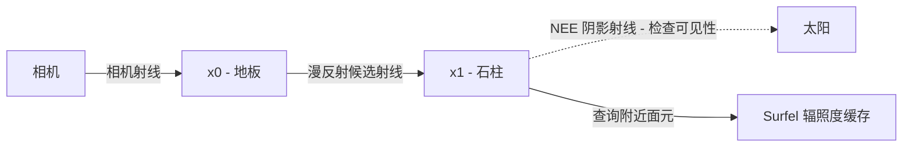

# ReSTIR GI + Surfel 算法学习笔记

这篇笔记用项目里的 Falcor 渲染阶段解释光从哪里来、每条射线在做什么，以及 Surfel 缓存如何进入 ReSTIR 的候选权重和最终着色。

## 第一个命中点与第二个命中点

以 Sponza 的一个像素为例。相机射线第一次打到阴影里的地板，命中点记为 x₀。程序再从 x₀ 的漫反射半球里采样一个方向，发出候选射线。如果它打到一根石柱，柱子上的交点就是 x₁。这里的“二次表面”指这条相机路径命中的第二块场景几何。随着像素和采样方向变化，x₁ 也可能落在墙、布帘或其他表面上。



图中的射线箭头按程序的追踪方向画。按光传播的方向看，**太阳 → 石柱 → 地板 → 相机**。石柱收到太阳的直接光，地板收到经石柱反射的一次间接光。“第二个命中点”数的是从相机出发经过的表面，“一次间接反弹”数的是光照到达可见地板前经历的反射。

## 关掉 Surfel 后，NEE 在哪里？

关闭 **Surfel cache**、**Temporal reuse** 和 **Spatial reuse** 后，间接光计算包含两次不同的采样。

1. **在 x₀ 采样方向。** 用余弦加权的半球分布采一条漫反射候选射线，找出 x₁。估计量用该方向的采样概率密度加权。每像素每帧只有一个方向候选，因此单帧候选图会有明显颗粒。
2. **在 x₁ 采样光源。** 下一事件估计（Next Event Estimation，NEE）从解析光源中采样，再用阴影射线判断该光是否可见，从而估计 x₁ 朝 x₀ 方向反射的直接光。Sponza 示例只有一盏太阳方向光。主表面 x₀ 的直接光也单独用同一个着色函数计算，写入 `GI.direct`。

因此，这段单次反弹路径用蒙特卡洛采样寻找 x₁，用 NEE 给 x₁ 着色。如果只关掉缓存，ReSTIR 仍可对一次反弹候选做时空复用。 [候选和直接着色实现](../Source/RenderPasses/SurfelReSTIRGI/SurfelReSTIRGI.cs.slang)

## Surfel 接在 x₁

开启缓存后，程序查询**石柱命中点 x₁ 附近**的 Surfel，获得入射辐照度 E_cache(x₁)。用石柱的漫反射反照率乘以该辐照度，再除以 π，就得到缓存贡献的出射亮度。候选的完整亮度是

```text
L_o(x₁) = L_direct(x₁) + ρ_d(x₁) × E_cache(x₁) / π
```

L_direct(x₁) 对应 **太阳 → 石柱 → 地板 → 相机**。缓存项也能带来 **太阳 → 红墙 → 石柱 → 地板 → 相机** 这类更长路径的贡献。红墙先把光反射到石柱，石柱再把带红色的光送到阴影里的地板。缓存查不到时，该候选仍保留石柱的一次反弹贡献。

合成后的 L_o(x₁) 同时参与 **ReSTIR 的选样权重**和**胜出样本的着色**。即使石柱上的 x₁ 看不见太阳，红墙反射到它的光仍能使这条路径获得贡献和权重。 [候选亮度与重采样数据结构](../Source/RenderPasses/SurfelReSTIRGI/Reservoir.slang)

## 在 Mogwai 里观察

用学习版渲染图固定机位，关闭两个复用开关，在 `CandidateIndirect.dst` 里切换 **Surfel cache**。重新开启后等缓存积累，再比较地板阴影的整片亮度和染色。

- `GI.candidateStatus` 显示候选射线的结果。绿色表示命中表面并查到缓存，橙色表示命中表面但未用到缓存，蓝色表示没有有效的二次命中。
- `SurfelOnly.dst` 展示在可见表面 x₀ 直接用缓存重建的间接光。`CandidateIndirect.dst` 则通过候选射线到 x₁ 查缓存，可以用来观察缓存如何进入 ReSTIR。

[Mogwai 学习版渲染图](../scripts/SurfelReSTIRGI_Study.py)
